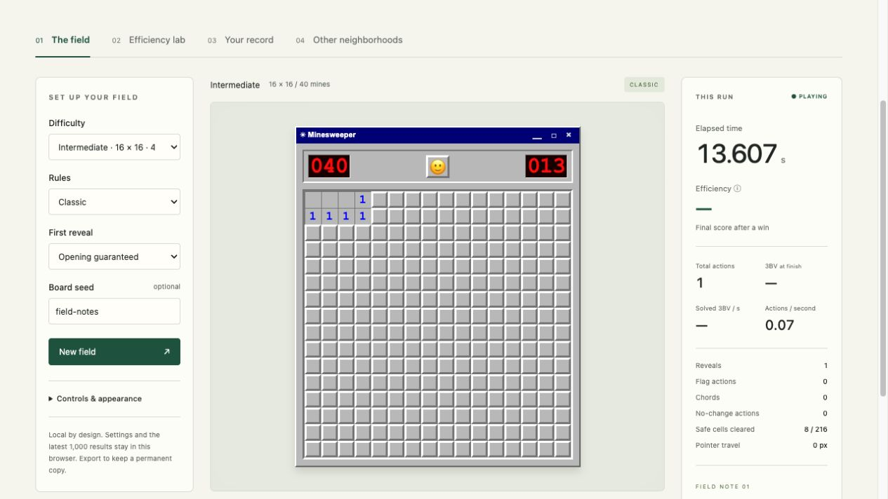

# Minesweeper Field Notes

An offline Minesweeper game, interactive learning guide, and mathematical exploration of efficient play and no-guess board generation.

The project combines the classic Minesweeper appearance with customizable controls, detailed statistics, experimental game modes, and reproducible research.

**[Play online](https://weiyu-ustc.github.io/Minesweeper/)** · **[Interactive tutorial](https://weiyu-ustc.github.io/Minesweeper/Minesweeper%20Tutorial.html)**



## Features

- **Classic gameplay:** familiar beveled tiles, flags, chording, custom board sizes, seeded generation, and configurable first-click protection.
- **Six game modes:** Classic, No Guess, No Flags, Click Budget, Crossfield, and Knightfield.
- **Detailed records:** elapsed time, action counts, wasted actions, 3BV, efficiency, game history, replay import/export, and CSV statistics.
- **Interactive tutorial:** 11 lessons spanning basic clues, bounded 1–2–1 and 1–2–2–1 patterns, subset deductions, chording, and advanced action planning.
- **Adaptive learning:** four selectable levels, a placement quiz, tailored hints, rotated pattern practice, and locally saved progress.
- **Offline operation:** no account, installation, or external runtime dependencies.

## Research

Two illustrated papers include mathematical derivations, simulations, editable LaTeX sources, and compiled PDFs.

### Efficiency and opening strategy

Efficiency is measured as:

**Efficiency (%) = 100 × board 3BV / total actions**

The paper explains the 3BV benchmark, flag and chord costs, shared setup, and the limitations of greedy strategies. Experiments include 1,500 paired boards and 90,000 first-click trials.

Under uniform placement conditioned on a safe first cell, corners maximize the probability of an initial zero. This does not establish the highest eventual efficiency or largest expected opening.

[Read the efficiency paper](papers/efficiency/efficiency.pdf) · [LaTeX source](papers/efficiency/main.tex) · [Initial-click data](papers/efficiency/initial-position-results.json)

### No-guess generation

The second paper models rejection-based generation as conditioning an initial board distribution on successful completion by a specified solver. It examines acceptance rates, retry limits, selection bias, and solver dependence, with exact enumeration of small boards.

No-guess certification concerns a sequence of safe deductions; the entire mine layout need not be uniquely determined initially.

[Read the no-guess paper](papers/no-guess/no-guess.pdf) · [LaTeX source](papers/no-guess/main.tex) · [Enumeration data](papers/no-guess/data/results.json)

## Getting Started

Play the [online game](https://weiyu-ustc.github.io/Minesweeper/) or open the [tutorial](https://weiyu-ustc.github.io/Minesweeper/Minesweeper%20Tutorial.html) directly in your browser. No installation or account is required.

To play offline:

1. Download or clone this repository, and extract it if downloaded as a ZIP.
2. Open `Minesweeper.html` in a modern browser.
3. Open `Minesweeper Tutorial.html` for the learning guide, or follow the tutorial link in the game.

For offline play, open the HTML files from the downloaded project; GitHub's repository file view displays their source. Keep the folders together so the paper and documentation links work. On macOS, `Start Minesweeper.command` also opens the game.

Progress and game history are saved in browser storage. Online and local-file versions have separate storage; records do not automatically sync between them or between devices. The [user guide](docs/USER_GUIDE.md) covers controls, modes, metric definitions, exports, and storage behavior.


## Project Structure

```text
Minesweeper.html              Standalone playable game
Minesweeper Tutorial.html     Standalone interactive course
index.html, app.js, style.css Game interface source
engine.js                    Game rules, scoring, generation, and solver
tutorial.html               Tutorial page source
tutorial.js                 Tutorial interactions and progress
tutorial-data.js            Lessons, puzzles, and placement questions
tutorial.css                Tutorial presentation
build-standalone.cjs          Rebuild or verify the standalone HTML files
data/                        Saved efficiency study and exact example
examples/                    Sample replay
research/                    Research notes and experiment scripts
papers/                      LaTeX sources, final PDFs, figures, and datasets
docs/                        Detailed user guide and screenshots
tests/                       Automated gameplay and tutorial checks
scripts/                     Repository maintenance checks
.github/workflows/           Automated GitHub checks
```

## Development

Use Node.js 24 or newer for the development commands. The project has no npm dependencies, so `npm install` is unnecessary.

```sh
npm run build       # Rebuild the two standalone HTML files
npm run check       # Run tests, verify bundles, and check local file links
```

The same checks can run directly with `node scripts/check.cjs` when npm is unavailable.

Edit the source HTML, JavaScript, and CSS files, then rebuild. Commit the source and both generated standalone HTML files together. GitHub Actions runs the same checks on pushes and pull requests.

### GitHub Pages

The site is a static website with `index.html` as its entry point. In repository **Settings → Pages**, use **Deploy from a branch**, select **main** and **/ (root)**, and save. GitHub publishes updates when changes are pushed to `main`. The root `.nojekyll` file disables Jekyll processing, preserving the existing file paths. No custom domain, package installation, or separate deployment build is needed.

The game, tutorial, and research PDFs use relative links and work under the `/Minesweeper/` project path. Keep the source assets and standalone HTML files together when deploying elsewhere.

Research regeneration is optional and overwrites the corresponding saved results:

```sh
npm run research:efficiency  # 1,500 paired boards; 4,500 policy runs
npm run research:exact       # Exhaustive small-board action search
npm run research:openings    # 90,000 first-click trials
npm run research:no-guess    # Exact enumeration and rejection-sampling checks
```

After regenerating efficiency data, run `npm run build` to refresh the in-game results. To regenerate the no-guess figures, run `python3 papers/no-guess/figures.py` with NumPy and Matplotlib installed. Rebuild the PDFs with `sh papers/build-papers.sh` using a LaTeX installation that includes the required packages, including TikZ/PGFPlots. Saved PDFs and figures can be read without these tools.

## Validation

The project includes 30 automated tests covering gameplay, deduction soundness, scoring, replays, generation, budgets, and tutorial exercises. The main browser interactions and all PDF pages have also been reviewed. The [user guide](docs/USER_GUIDE.md#verification-and-reproducing-the-research) records the scope and limits of those checks.

The research distinguishes proven results, model assumptions, and empirical findings. It does not claim a universally optimal strategy for human play.
